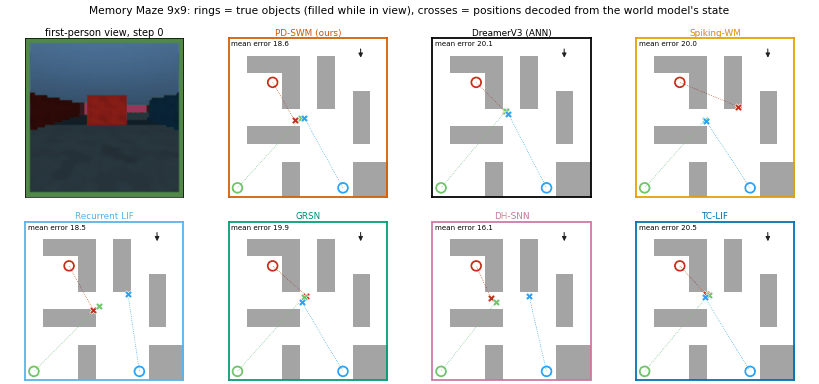
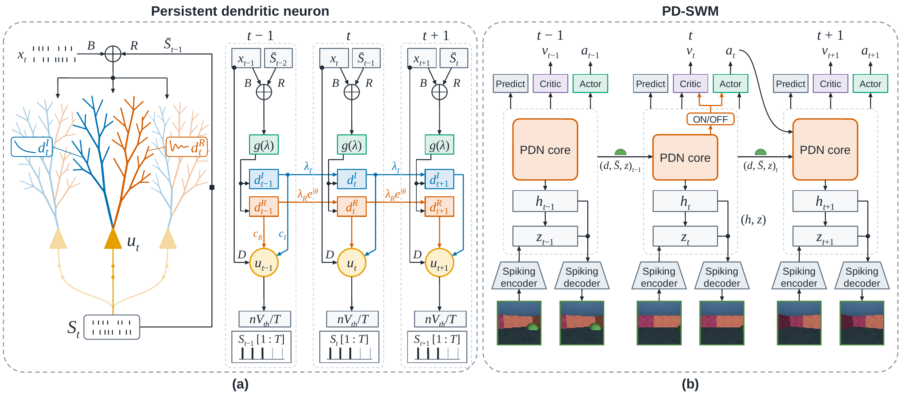
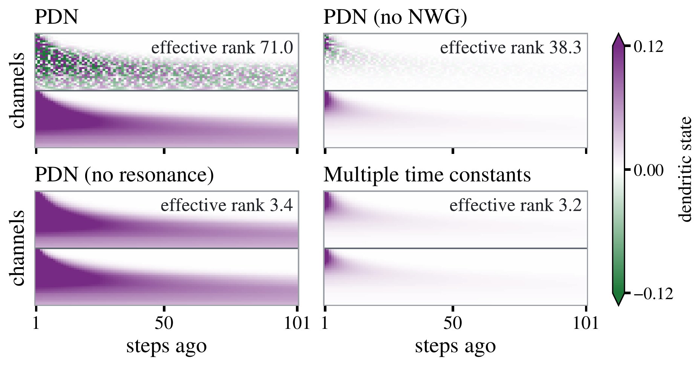
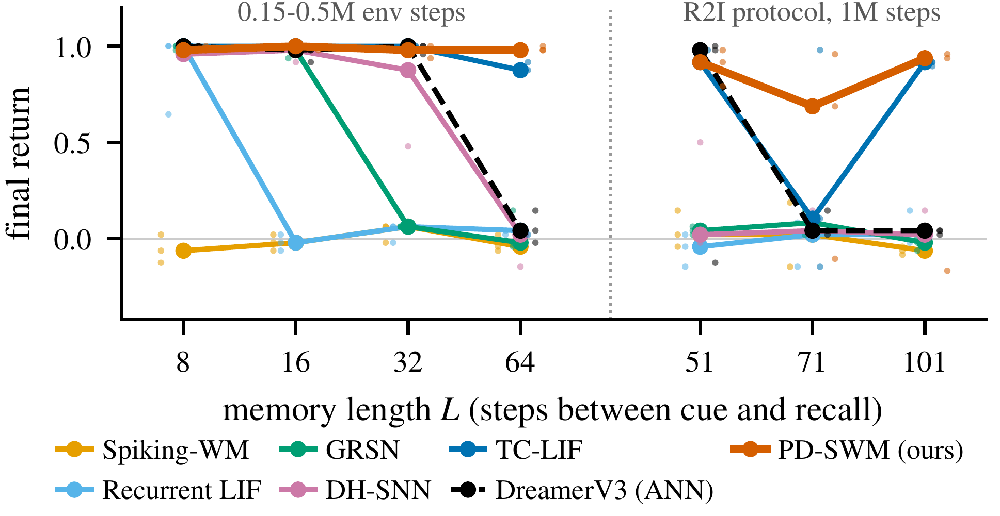
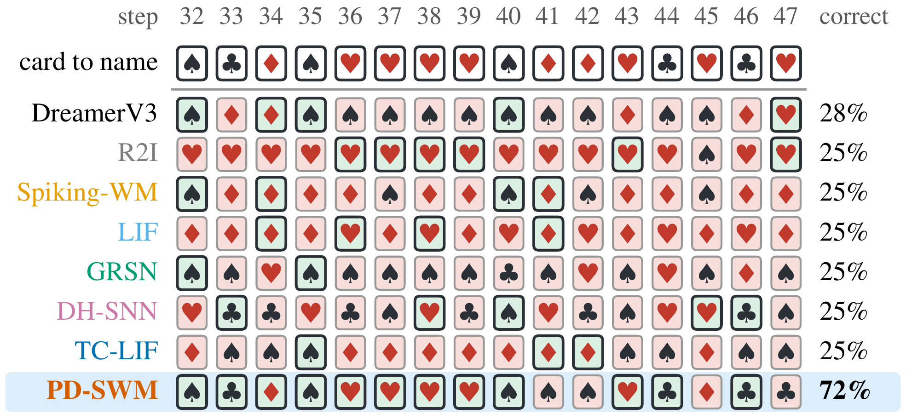
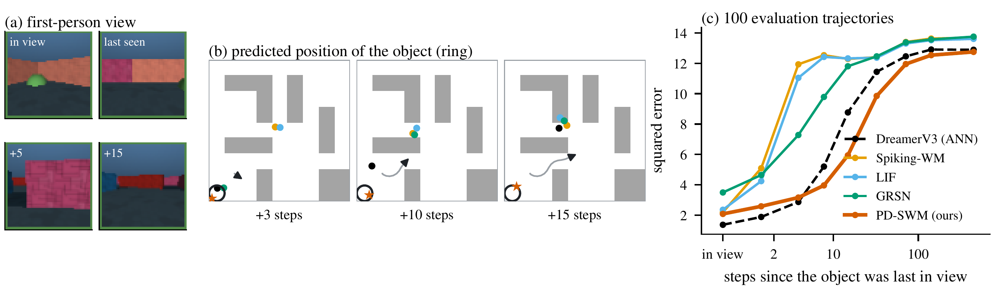
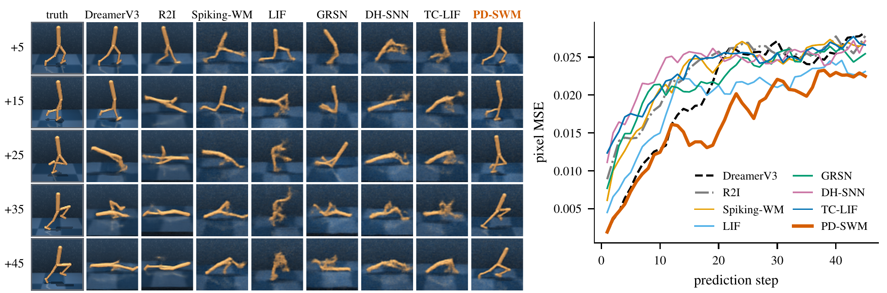
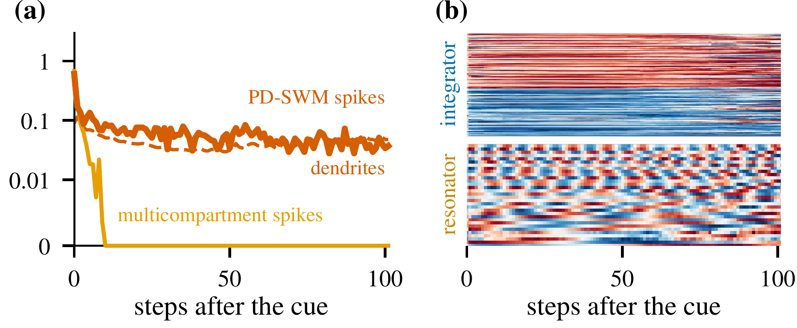

<div align="center">

# PD-SWM

### Spiking World Models with Persistent Dendritic Neurons

[](#installation)
[](https://pytorch.org/)
[](#installation)
[](LICENSE)

[Highlights](#highlights) •
[Method](#method) •
[Results](#results) •
[Installation](#installation) •
[Training](#training) •
[Models](#models-and-config-blocks) •
[Layout](#repository-layout)



<sub>Memory Maze 9×9. Rings are the true objects (filled while in view), crosses are the positions decoded from the
state of each world model.</sub>

</div>

## Highlights

PD-SWM is an SNN world model for model-based reinforcement learning in partially observable environments. Its
sequence model is built from **Persistent Dendritic Neurons (PDNs)**: the dendrites store the memory, and the soma
fires the spikes.

<table>
<tr>
<td align="center" width="25%"><b>BSuite memory length</b><br><br><code>L = 8 → 101</code><br><sub>the only model that learns every length</sub></td>
<td align="center" width="25%"><b>RepeatPrevious Medium</b><br><br><code>72% correct</code><br><sub>all other models stay at the 25% chance level</sub></td>
<td align="center" width="25%"><b>World model probes</b><br><br><code>AUC 0.92 / 0.94</code><br><sub>the only model that recalls exactly 32 and 64 steps back</sub></td>
<td align="center" width="25%"><b>Walker walk</b><br><br><code>923 / 929</code><br><sub>proprio / pixels, close to DreamerV3 (953 / 968)</sub></td>
</tr>
</table>

- **Long-term memory in RL.** On BSuite memory length, PD-SWM acts on a cue seen 101 steps earlier. DreamerV3 stops
  at 51 steps, and the best SNN baseline, TC-LIF, fails at 71.
- **Memory of when.** On POPGym RepeatPrevious Medium, PD-SWM is the only model clearly above chance within 2M
  steps. Its world model is the only one that learns the held-out interval of 64 steps.
- **Spatial memory from first-person vision.** In Memory Maze, PD-SWM locates objects out of view more accurately
  than every SNN world model and DreamerV3.
- **Prediction and control.** On walker walk from pixels, PD-SWM has the lowest open-loop prediction error of all
  models and keeps its control returns.

## Method

SNN world models approach the control performance of ANN world models, but they struggle to recall cues from the
distant past. Two problems of existing spiking neurons cause this:

- **Evolution of the state over time.** Distant inputs leave traces that are too weak, and the times at which
  inputs occurred are hard to tell apart.
- **Spike readout.** Resetting the state at firing overwrites the stored memory.

A PDN solves the first problem with **Persistent Dendritic Memory (PDM)** and a **Normalized Write Gain (NWG)**,
and the second with a **Stateless Somatic Readout (SSR)**.

<p align="center">
  
</p>
<p align="center"><sub>
  <b>(a)</b> A layer of PDNs over three environment steps. Integrator (blue) and resonant (vermilion) dendritic
  channels carry their state across steps, and the soma reads them out as spikes.
  <b>(b)</b> The world model unrolled over three steps. The state (d, S̄, z) carries over to the next step, and the
  actor and critic also read the ON/OFF spike encoding of the dendritic state.
</sub></p>

A PDN layer has $N$ neurons with $M$ dendritic channels each and is updated once per environment step.
The firing rates of the input spikes $x_t$ and of the layer's own spikes $\bar S_{t-1}$ are written into the
dendrites through the synapses $B$ and $R$:

```math
I_t = B\,x_t + R\,\bar S_{t-1}
```

<table>
<tr><td width="33%" valign="top">

**Persistent Dendritic Memory**

Each dendritic channel is a damped oscillator.

```math
d_t = \lambda e^{i\theta} d_{t-1} + g(\lambda)\, I_t
```

with $\lambda = e^{-1/\tau}$. The retention time $\tau$ (initialized between 1 and 1000 environment steps) sets
how long a channel remembers. The phase $k\theta$ of a trace marks how long ago its input arrived. Firing never
resets $d_t$, and it keeps evolving during imagined rollouts.

</td><td width="33%" valign="top">

**Normalized Write Gain**

With the leaky write $g = 1-\lambda$, channels with long retention store weak traces. NWG gives every channel
unit energy:

```math
g(\lambda) = \sqrt{1-\lambda^2}
```

Distant traces then stay strong enough to drive the readout. $g$ is computed from the learned $\lambda$ during
training and is a constant at inference.

</td><td width="33%" valign="top">

**Stateless Somatic Readout**

The soma integrates the dendrites with the current input and fires over the $T$ simulation steps with $T$
increasing thresholds:

```math
u_t = \textstyle\sum_{m} \mathrm{Re}(c_m \odot d_{t,m}) + D\,x_t
```

```math
S_t[n] = \Theta\!\left(u_t - n V_{\mathrm{th}}/T\right)
```

The soma has no state to reset, so firing leaves the memory intact.

</td></tr>
</table>

<p align="center">
  
</p>
<p align="center"><sub>
  Inputs at different times leave independent traces in the dendrites. Column k is the dendritic state left by a
  unit input k steps earlier (τ and θ from the BSuite L = 101 agent). The effective rank of these traces is 71.0
  with PDM, 3.4 without resonance and 38.3 without NWG.
</sub></p>

The rest of the agent follows DreamerV3: a spiking encoder and decoder, a latent posterior and prior, reward and
continuation heads, and an actor and critic trained in imagination. All modules are SNNs.

| Component | Code | Config block |
|---|---|---|
| Two-layer PDN core with persistent dendrites, PDM and NWG | `networks.PDRNN` | `ours` |
| Half of each neuron's channels resonant, half integrators | `PDRNN(resonant=0.5)` | `resonanthalf` |
| Two dendritic channels per neuron | `PDRNN(channels=2)` | `pdch2` |
| Stateless soma, spike count over $T=5$ steps | `PDRNN(soma='thermo')` | `somathermo` |
| Spike feedback $R \bar S_{t-1}$ into the dendrites | `PDRNN(spike_feedback=True)` | `pdfeedback` |
| Actor and critic read the dendrites as ON/OFF spikes | `policy_mem='onoff'` | `policymem` |
| Rank-64 weights from these spikes to the actor and critic | `ac_rank=64` | `aclowrank` |

## Results

All spiking models share one world model of the size of DreamerV3-S and differ only in the sequence model.
DreamerV3 uses the same architecture with a GRU core and no spikes. R2I is an ANN world model designed for memory
tasks. Within a benchmark, all models use the same hyperparameters, training budget and evaluation.

### Memory in reinforcement learning

<p align="center">
  
</p>
<p align="center"><sub>
  Final return on BSuite memory length, where the agent is rewarded only if it recalls a cue seen L steps
  earlier (1 = always correct, 0 = chance). Lines give the median of three seeds, and dots the single seeds.
</sub></p>

How far an SNN world model remembers depends on how its neurons keep their state. Spiking-WM and recurrent LIF
clear their state at every environment step and remember at most 8 steps. GRSN and DH-SNN keep their state, but it
leaks away after 16 and 32 steps. TC-LIF learns 101 steps but fails at 71. PD-SWM succeeds at every length.

**BSuite memory length** (✅ = evaluation return reaches 0.9 within the budget in at least two of three seeds)

| Method | L=8 | 16 | 32 | 64 | 51† | 71† | 101† |
|:--|:-:|:-:|:-:|:-:|:-:|:-:|:-:|
| *Budget (env steps)* | *150k* | *200k* | *300k* | *500k* | *1M* | *1M* | *1M* |
| DreamerV3 (ANN) | ✅ | ✅ | ✅ | ❌ | ✅ | ❌ | ❌ |
| R2I (ANN)‡ | – | – | – | – | ✅ | ✅ | ❌ |
| Spiking-WM | ❌ | ❌ | ❌ | ❌ | ❌ | ❌ | ❌ |
| Recurrent LIF | ✅ | ❌ | ❌ | ❌ | ❌ | ❌ | ❌ |
| GRSN | ✅ | ✅ | ❌ | ❌ | ❌ | ❌ | ❌ |
| DH-SNN | ✅ | ✅ | ✅ | ❌ | ❌ | ❌ | ❌ |
| TC-LIF | ✅ | ✅ | ✅ | ✅ | ✅ | ❌ | ✅ |
| **PD-SWM (ours)** | ✅ | ✅ | ✅ | ✅ | ✅ | ✅ | ✅ |

<sub>† Lengths and budget of R2I. ‡ Results reported in the R2I paper (median of its 10 runs); – = not reported.</sub>

**POPGym, Memory Maze and DeepMind Control** (best in **bold**)

| Method | RepeatPrevious Easy ↑ | RepeatPrevious Medium ↑ | Memory Maze object MSE ↓ | Memory Maze walls % ↑ | Walker proprio ↑ | Walker pixels ↑ |
|:--|:-:|:-:|:-:|:-:|:-:|:-:|
| *Budget* | *2M steps* | *2M steps* | *1M updates* | *1M updates* | *500k steps* | *1M frames* |
| DreamerV3 (ANN) | 0.38 | −0.43 | 9.8 | 85.3 | **953** | **968** |
| R2I (ANN) | −0.51 | −0.50 | **3.6** | **85.8** | 916 | 858 |
| Spiking-WM | 0.44 | −0.50 | 11.8 | 83.5 | 923 | 917 |
| Recurrent LIF | **0.68** | −0.51 | 11.7 | 83.7 | 807 | 943 |
| GRSN | 0.31 | −0.50 | 11.5 | 83.3 | 863 | 803 |
| DH-SNN | −0.43 | −0.49 | 11.9 | 83.3 | 917 | 860 |
| TC-LIF | 0.01 | −0.50 | 12.3 | 82.7 | 807 | 589 |
| **PD-SWM (ours)** | **0.68** | **0.45** | 9.0 | 83.8 | 923 | 929 |

<sub>RepeatPrevious: mean return of the final agent over 512 episodes; chance is −0.5. Memory Maze: offline
probes of the world model state; a constant predictor reaches an object MSE of 24.0 and a wall accuracy of
80.8%.</sub>

<p align="center">
  
</p>
<p align="center"><sub>
  Recall in RepeatPrevious Medium. The top row is the card to name, shown 32 steps earlier. The rows below are the
  cards the final agents name, green when correct and red when wrong. The last column is the fraction of correct
  answers over 512 episodes (chance 25%).
</sub></p>

<details>
<summary><b>Seeds and learning speed on BSuite</b></summary>
<br>

| Method | L=8 | 16 | 32 | 64 | 51† | 71† | 101† |
|:--|:-:|:-:|:-:|:-:|:-:|:-:|:-:|
| ***Seeds (of 3) that reach 0.9*** | | | | | | | |
| DreamerV3 (ANN) | 3 | 3 | 3 | 0 | 2 | 0 | 0 |
| Spiking-WM | 0 | 0 | 1 | 0 | 0 | 0 | 0 |
| Recurrent LIF | 3 | 0 | 0 | 0 | 1 | 0 | 0 |
| GRSN | 3 | 3 | 0 | 0 | 0 | 0 | 0 |
| DH-SNN | 3 | 3 | 2 | 0 | 0 | 0 | 0 |
| TC-LIF | 3 | 3 | 3 | 2 | 3 | 1 | 3 |
| **PD-SWM (ours)** | 3 | 3 | 3 | 3 | 3 | 2 | 2 |
| ***Env steps until the return first reaches 0.9*** | | | | | | | |
| DreamerV3 (ANN) | **12k** | 22k | 92k | – | 902k | – | – |
| R2I (ANN)‡ | | | | | 790k | 520k | – |
| Spiking-WM | – | – | – | – | – | – | – |
| Recurrent LIF | 132k | – | – | – | – | – | – |
| GRSN | 22k | 122k | – | – | – | – | – |
| DH-SNN | 32k | 92k | 192k | – | – | – | – |
| TC-LIF | **12k** | 22k | **22k** | 142k | 102k | – | **242k** |
| **PD-SWM (ours)** | **12k** | **12k** | **22k** | **102k** | **62k** | **242k** | **242k** |
| ***Final return*** | | | | | | | |
| DreamerV3 (ANN) | **1.00** | 0.98 | **1.00** | 0.04 | **0.98** | 0.04 | 0.04 |
| R2I (ANN)‡ | | | | | 0.93 | **0.89** | 0.32 |
| Spiking-WM | −0.06 | −0.02 | 0.06 | −0.04 | 0.02 | 0.02 | −0.06 |
| Recurrent LIF | **1.00** | −0.02 | 0.06 | 0.04 | −0.04 | 0.02 | 0.02 |
| GRSN | **1.00** | 0.98 | 0.06 | −0.02 | 0.04 | 0.08 | −0.02 |
| DH-SNN | 0.96 | 0.98 | 0.88 | 0.02 | 0.02 | 0.04 | 0.02 |
| TC-LIF | **1.00** | **1.00** | **1.00** | 0.88 | 0.92 | 0.10 | 0.92 |
| **PD-SWM (ours)** | 0.98 | **1.00** | 0.98 | **0.98** | 0.92 | 0.69 | **0.94** |

<sub>Steps and final returns are the median of three seeds; – means that fewer than two seeds reach 0.9. The final
return is the mean of the last three evaluations. ‡ R2I: median learning curve of its 10 runs, from the R2I
paper; not reported for L = 8 to 64.</sub>

</details>

### Visual spatial memory

In Memory Maze, once a target object leaves the view, the world model has to locate it from the history kept in
its state. A memoryless probe that reads only the current image reaches an object MSE of about 12. The SNN
baselines improve on it by at most 0.5, so their states hold almost only the current view. PD-SWM improves on it
by 2.9, more than the 2.0 of DreamerV3.

<p align="center">
  
</p>
<p align="center"><sub>
  Memory of objects out of view. (a) First-person views: an object stays in view for 5 steps and then leaves it.
  (b) Object positions predicted 3, 10 and 15 steps after the object left the view; the ring is the true
  position and the star is PD-SWM. (c) Squared error against the steps since the object left the view, over 100
  evaluation trajectories.
</sub></p>

### Prediction without observations

The policy learns in imagination, so the world model also has to keep predicting without new observations. When
the world models observe 5 frames and then predict 45 frames from the actions alone, PD-SWM has the lowest mean
error of all models, including the ANN world models DreamerV3 and R2I.

<p align="center">
  
</p>
<p align="center"><sub>
  Open-loop prediction on walker walk from pixels. The right panel gives the pixel MSE averaged over 8 segments.
</sub></p>

### World model probes

The return in RL also depends on exploration and credit assignment. To measure memory alone, we train the world
models on data from a random policy and score reward predictions that depend on the past (AUC, 0.5 = no memory).
Cue recall asks for the cue $L$ steps back. RepeatPrevious asks whether the action names the card from exactly $k$
steps back, which needs the time of each input.

| Method | Cue recall L=8 | 16 | 32 | 64 | RepeatPrevious k=4 | 32 | 64* |
|:--|:-:|:-:|:-:|:-:|:-:|:-:|:-:|
| DreamerV3 (ANN) | **1.00** | **1.00** | **1.00** | 0.50 | 0.95 | 0.50 | 0.50 |
| Spiking-WM | 0.49 | 0.54 | 0.66 | 0.52 | 0.97 | 0.50 | 0.50 |
| Recurrent LIF | **1.00** | 0.52 | 0.50 | 0.50 | **0.99** | 0.50 | 0.50 |
| GRSN | **1.00** | **1.00** | 0.51 | 0.51 | 0.89 | 0.51 | 0.50 |
| DH-SNN | **1.00** | **1.00** | **1.00** | 0.52 | 0.63 | 0.50 | 0.50 |
| TC-LIF | **1.00** | **1.00** | **1.00** | **1.00** | 0.86 | 0.50 | 0.57 |
| **PD-SWM (ours)** | **1.00** | **1.00** | **1.00** | **1.00** | 0.98 | **0.92** | **0.94** |

<sub>* Held out as a test.</sub>

DH-SNN and TC-LIF both recall a cue from 32 steps back, yet both fail at $k=32$: neither can tell when an input
occurred. PD-SWM learns $k=32$ and the held-out $k=64$, both in 8k updates. Its resonant channels record time at
their own frequencies.

<p align="center">
  
</p>
<p align="center"><sub>
  Where the cue is kept. The BSuite L = 101 agents read two episodes that differ only in the cue.
  (a) Difference in spikes and dendritic states between the two episodes, relative to their mean magnitude.
  (b) Difference in each dendritic channel of PD-SWM with a retention time above 100 steps: integrators hold the
  cue with a fixed sign, and the phase of resonators rotates with the elapsed time.
</sub></p>

### Ablations

| Variant | Cue recall L=32 | Cue recall L=64 | RepeatPrevious k=32 |
|:--|:-:|:-:|:-:|
| Dendrites cleared at every environment step (no PDM across steps) | 0.51 | 0.50 | 0.50 |
| No resonant channels | **1.00** | **1.00** | 0.57 |
| Write gain $1-\lambda$ instead of NWG | **1.00** | 0.52 | 0.76 |
| Soma with a membrane that is reset on firing (no SSR) | **1.00** | 0.52 | 0.77 |
| **PD-SWM** | **1.00** | **1.00** | **0.92** |

Without persistent dendrites no history survives across steps. Without resonance the time of an input can no
longer be told apart. Without NWG the long channels are written too weakly, and without SSR the readout depends
on earlier spikes. PDM, NWG and SSR are all necessary.

<details>
<summary><b>Size control</b></summary>
<br>

RepeatPrevious probe at $k=32$. The baselines widen $h_t$ from 512 to 1024 dimensions, and PD-SWM keeps 512.

| Method | $h_t$ | World model params | AUC |
|:--|:-:|:-:|:-:|
| DreamerV3 (ANN) | 512 → 1024 | 7.4M → 11.8M | 0.50 → 0.50 |
| Spiking-WM | 512 → 1024 | 7.1M → 10.8M | 0.50 → 0.50 |
| Recurrent LIF | 512 → 1024 | 6.3M → 8.7M | 0.50 → 0.50 |
| GRSN | 512 → 1024 | 6.3M → 8.2M | 0.51 → 0.51 |
| DH-SNN | 512 → 1024 | 6.3M → 8.7M | 0.50 → 0.50 |
| TC-LIF | 512 → 1024 | 6.3M → 8.7M | 0.50 → 0.50 |
| **PD-SWM (ours)** | 512 | 8.4M | **0.92** |

Removing the spike feedback $R$ shrinks the world model of PD-SWM to 7.4M, the size of DreamerV3. Its AUCs on the
three ablation probes are then 1.00, 1.00 and 0.94.

</details>

## Installation

```bash
git clone https://github.com/wxqnl/PD-SWM.git && cd PD-SWM
conda env create -f environment.yml      # Python 3.10, PyTorch 2.4.1, CUDA 12.4
conda activate pd-swm
pip install -r requirements.txt
```

DeepMind Control from pixels renders with OSMesa (`MUJOCO_GL=osmesa`, set by `scripts/train.sh`).

<details>
<summary><b>Memory Maze data</b></summary>

The official Memory Maze 9x9 offline dataset (Pasukonis et al., 2023), read directly from its zip archives:

```bash
bash scripts/data/download_memory_maze.sh eval train-part0 train-part1 ... train-part9
# -> data/memory_maze_9x9_official
```

</details>

<details>
<summary><b>Minecraft Diamond</b></summary>

MineRL 0.4.4 (Minecraft 1.11.2) needs Python 3.11, Java 8 and an X display (Xvfb), so it has its own environment
with the patched MineRL build of dreamerv3-torch:

```bash
conda create -n pd-swm-mc -c conda-forge python=3.11 openjdk=8
conda activate pd-swm-mc
pip install torch==2.4.1 --index-url https://download.pytorch.org/whl/cu124
pip install https://github.com/NM512/minerl/releases/download/v0.4.4-patched/minerl_mirror-0.4.4-cp311-cp311-linux_x86_64.whl \
  gym==0.23.1 numpy==1.23.5 opencv-python==4.10.0.84 ruamel.yaml==0.17.4 einops==0.8.0 cloudpickle==3.0.0 tensorboard
```

On machines with many cores, `scripts/pin_minerl_cpus.py` keeps the MineRL JVMs off the cores of the training
processes, and `scripts/clean_minerl_tmp.py` removes the copies of Minecraft that crashed clients leave in `/tmp`.

</details>

## Training

`scripts/train.sh <task> [seed] [logdir]` runs PD-SWM with the settings of our experiments:

```bash
bash scripts/train.sh bsuite_memlen-101             # BSuite memory length 101 (protocol of R2I), 1M env steps
bash scripts/train.sh popgym_RepeatPreviousMedium   # POPGym RepeatPrevious, 2M env steps
bash scripts/train.sh dmc_walker_walk               # DMC walker from proprioception, 500k env steps
bash scripts/train.sh dmcpix_walker_walk            # DMC walker from pixels, 1M env steps
bash scripts/train.sh bsuite_memlen-64-recall       # world model alone: recall of a cue 64 steps back
bash scripts/train.sh memory_maze_9x9               # Memory Maze offline probing, 1M updates
PYTHON=$(which python) bash scripts/run_minecraft.sh 0   # Minecraft Diamond on GPU 0, 100M env steps (pd-swm-mc)
```

| Task | Benchmark | Budget |
|---|---|---|
| `bsuite_memlen-{8,16,32,64}` | BSuite memory length | 150k to 500k env steps |
| `bsuite_memlen-{51,71,101}` | BSuite memory length, protocol of R2I | 1M env steps |
| `popgym_RepeatPrevious{Easy,Medium}` | POPGym RepeatPrevious | 2M env steps |
| `dmc_{walker_walk,cheetah_run,cartpole_swingup}` | DeepMind Control from proprioception | 500k env steps |
| `dmcpix_walker_walk` | DeepMind Control from pixels | 1M env steps |
| `bsuite_memlen-{8,16,32,64,101}-recall` | world model probe: recall of a cue $L$ steps back | 12k updates |
| `memory_maze_9x9` | Memory Maze 9x9 offline probing | 1M updates |
| `minecraft_diamond` | Minecraft Diamond (via `scripts/run_minecraft.sh`) | 100M env steps |

Each task maps to one `dreamer.py` command, for example

```bash
python dreamer.py --configs bsuite ours resonanthalf policymem aclowrank somathermo pdfeedback pdch2 rewardbyact \
  --task bsuite_memlen-101 --steps 1e6 --train_ratio 64 --reward_head symlog_mse --batch_length 128 \
  --eval_every 20000 --env_seed_per_env True --seed 0 --logdir runs/pd-swm/bsuite_memlen-101/s0
```

A run writes `metrics.jsonl` (training and evaluation metrics), TensorBoard events and `latest_model.pt` to its
logdir and resumes from them. `probe_mm.py` writes `model.pt` and resumes from it.

## Models and config blocks

`--configs` takes the benchmark block (`bsuite`, `popgym`, `dmc_proprio`, `dmc_vision`, `minecraft`, `mmprobe`)
followed by the blocks of the model. PD-SWM uses the same configuration on every task. All models share the world
model and differ only in the recurrent core of the sequence model:

| Model | Blocks | Core |
|---|---|---|
| **PD-SWM** | `ours resonanthalf policymem aclowrank somathermo pdfeedback pdch2` | `PDRNN` |
| Spiking-WM (Sun et al., 2025) | none | `MCRNN` |
| LIF | `lifcell` | `LIFRNN` |
| GRSN (Qin et al., 2025) | `grsn` | `GRSNCell` |
| DH-SNN (Zheng et al., 2024) | `dhsnn` | `DHSNNCell` |
| TC-LIF (Zhang et al., 2024) | `tclif` | `TCLIFCell` |
| DreamerV3 (ANN) | `grucell annwm` | `GRUCtrl` |
| Spiking-WM with reset interventions | `persist nodendreset taud128 dendgain` | `MCRNN` |

To train a baseline, replace the model blocks of a command, e.g.
`python dreamer.py --configs bsuite tclif rewardbyact --task bsuite_memlen-101 ...`.

- On BSuite every model adds `rewardbyact` (reward head indexed by the action).
- On Memory Maze, which has no actor or critic, PD-SWM drops `aclowrank`.
- The world model probes (`probe_wm.py`) use the world-model blocks `ours resonanthalf somathermo pdfeedback pdch2`.
- Further variants of the PDN core (`pdreset`, `pdeuler`, `pdfixtau`, `pdsomalif`, ...) are described in the
  comments of `configs.yaml`.

<details>
<summary><b>External baseline: Recall to Imagine (R2I)</b></summary>

Clone [Recall2Imagine](https://github.com/chandar-lab/Recall2Imagine) (commit `6e317e7`) into
`external/Recall2Imagine`, install its environment and apply the action-repeat fix (without it every DMC episode
after the first runs at action repeat 1):

```bash
git -C external/Recall2Imagine apply ../../scripts/patches/r2i_action_repeat.patch
R2I_PYTHON=<its python> bash scripts/run_r2i.sh popgym gym_popgym:popgym-RepeatPreviousEasy-v0 2e6 <gpu> <logdir>
```

DMC: `"dmc_proprio small" dmc_walker_walk 2.5e5` or `dmc_vision dmc_walker_walk 5e5` (500k / 1M frames; `small`
sets the widths of the other models). Memory Maze:
`$R2I_PYTHON probe_mm_r2i.py --configs mmaze small --logdir <logdir> --mm_updates 1000000`.
Minecraft: also apply `scripts/patches/r2i_minecraft.patch`, install MineRL 0.4.4 into the R2I environment, and run
`R2I_PYTHON=<its python> JAVA_HOME=<env with Java 8> bash scripts/run_r2i_minecraft.sh <gpu> [seed]`.

</details>

## Repository layout

```
.
├── dreamer.py             RL training entry (DreamerV3 loop)
├── models.py              world model, actor and critic, imagination
├── networks.py            RSSM and its recurrent cores: PDRNN (PD-SWM), MCRNN (Spiking-WM), LIFRNN,
│                          GRSNCell, DHSNNCell, TCLIFCell, GRUCtrl; spiking encoder and decoder
├── node.py, surrogate.py  spiking neurons (LIF, multicompartment) and surrogate gradients
├── normalization.py       normalization layers (PopNorm)
├── tools.py, exploration.py, parallel.py
│                          logging, replay, environment workers (from dreamerv3-torch)
├── probe_wm.py            world model memory probe: cue recall on BSuite and POPGym
├── probe_mm.py            Memory Maze offline probing benchmark
├── probe_mm_r2i.py        the same benchmark for R2I (official JAX code, R2I's environment)
├── mm_data.py             Memory Maze offline trajectories and TBTT streams (numpy only)
├── energy.py              synaptic operations per environment step of a trained agent
├── configs.yaml           defaults and named config blocks
├── envs/                  BSuite memory length, POPGym, DeepMind Control, Minecraft Diamond
├── scripts/
│   ├── train.sh           PD-SWM on one task with the settings of our experiments
│   ├── run_minecraft.sh   one model on Minecraft Diamond (X display, relaunch after a crash)
│   ├── run_r2i.sh         R2I baseline (official code) on POPGym and DMC
│   ├── run_r2i_minecraft.sh  R2I on Minecraft Diamond
│   ├── eval_popgym*.py    re-evaluates trained POPGym agents, latent sampled or at its mode (ours and R2I)
│   ├── prune_episodes.py  deletes saved episodes older than the replay of long runs (disk)
│   ├── clean_minerl_tmp.py, pin_minerl_cpus.py   MineRL housekeeping on many-core machines
│   ├── patches/           fixes applied to the R2I code
│   └── data/              Memory Maze download and preparation
└── assets/                README figures
```

`data/`, `external/` and `runs/` are created locally and are not tracked.

## Acknowledgements

The code builds on [dreamerv3-torch](https://github.com/NM512/dreamerv3-torch) and on the code of
[Spiking-WM](https://github.com/Brain-Cog-Lab/Spiking-WM) (Sun et al., PNAS 2025), which is also our main
baseline. We thank the authors of Recall2Imagine, Memory Maze, BSuite, POPGym and the DeepMind Control Suite, and
of the GRSN, DH-SNN and TC-LIF neurons, for releasing their code.

## License

Apache License 2.0, see [`LICENSE`](LICENSE).
